# Pol Casacuberta Gil

> **AI & ML Engineer and Team Lead @ Deloitte** | **Physical AI, Computer Vision, Agentic AI** | **CS Graduate, UPC**

  
  
  

I lead a small team at Deloitte building Physical AI and agentic AI systems: real-time computer vision, digital twins on NVIDIA Omniverse and Isaac Sim, and RAG platforms deployed across AWS, Azure, and GCP. I graduated in Computer Science from the Universitat Politècnica de Catalunya (UPC) in 2023. I am always open to collaborating on interesting open-source projects!

---

### 🛠️ Tech Stack

  
  
  
  
  
  
  
  
  
  
  
  
  

---

### 📊 GitHub Stats

<!--
  These SVGs are refreshed daily by .github/workflows/refresh-stats.yml so the
  README never breaks when github-readme-stats.vercel.app is down.
-->

  
  &nbsp;&nbsp;&nbsp;&nbsp;
  

